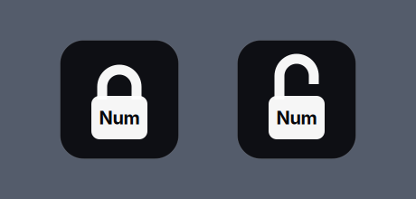
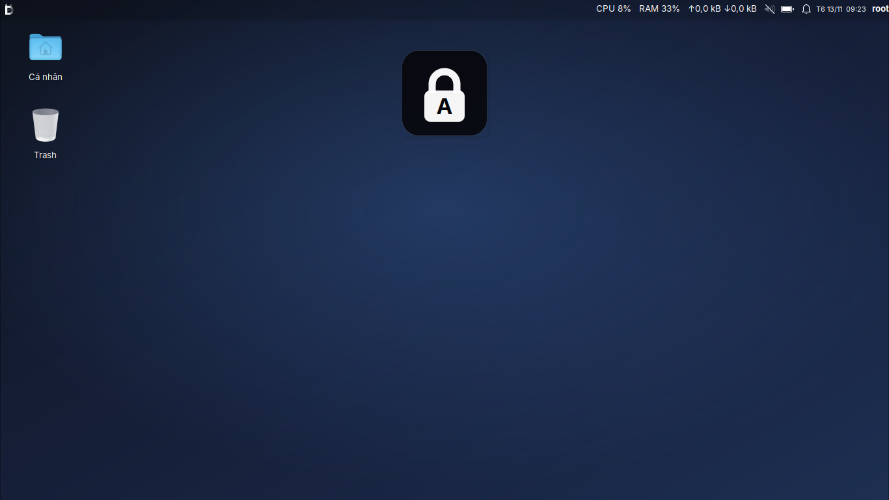
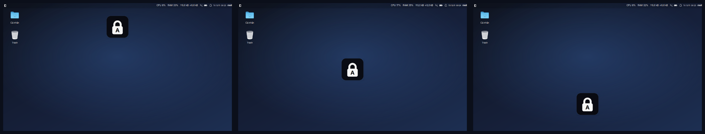

# depot-capslock — ô báo Caps Lock và Num Lock của Depot OS, đóng thành gói `.deb`

Mỗi lần bấm Caps Lock hoặc Num Lock, một ô vuông bo góc hiện trên màn hình hơn một giây rồi tự tắt:

- **Caps Lock bật** → ổ khoá đóng + chữ `A`; **tắt** → ổ khoá mở + chữ `a`
- **Num Lock bật** → ổ khoá đóng + chữ `Num`; **tắt** → ổ khoá mở + chữ `Num` (từ bản 1.1.0)

Ô báo vẽ bằng cairo (không cần bộ icon nào), không chiếm bàn phím, chuột bấm xuyên qua được.
Đây là ô báo có sẵn trong Depot OS (`depot-notify`), tách ra để cài được trên máy Debian / Ubuntu bất kỳ.

## Hình ảnh

**Bật và tắt** — trái: Caps Lock bật (ổ khoá đóng, chữ `A`); phải: Caps Lock tắt (ổ khoá mở, chữ `a`).


**Num Lock** — cùng ô báo, trong ổ khoá ghi chữ `Num`; trái: bật, phải: tắt.



**Trên màn hình** — ô báo hiện giữa theo chiều ngang, phía trên, không che cửa sổ đang làm việc và tự tắt sau hơn một giây.



**Chọn chỗ hiện** — `POSITION=top` (mặc định), `center`, `bottom` trong `~/.config/depot-capslock.conf`.



Ảnh chụp bản 1.0.1 trong phiên XFCE của Depot OS v0.25 (màn hình ảo 1366×768); ảnh Num Lock vẽ từ bản 1.1.0.

| | |
|---|---|
| Tệp cài | [`depot-capslock_1.1.0_all.deb`](depot-capslock_1.1.0_all.deb) (kèm [`.sha256`](depot-capslock_1.1.0_all.deb.sha256)) — cũng có ở [GitHub Releases, bản `depot-capslock-1.1.0`](https://github.com/nguyenquocanhz/depot-os/releases/tag/depot-capslock-1.1.0) |
| Viết cho | Debian, Ubuntu và các bản dựa trên chúng có GTK 3.22 trở lên — phiên **X11**: XFCE, MATE, Cinnamon, LXQt, i3, Openbox (đã thử trên Debian 13 + XFCE và Ubuntu 24.04 + Openbox, xem cuối trang) |
| Cần | `python3`, `python3-gi`, `python3-gi-cairo`, `gir1.2-gtk-3.0` (apt tự kéo); nên có `fonts-inter` |
| Không chạy | phiên Wayland (GNOME / KDE mặc định): Wayland không báo trạng thái Caps Lock cho chương trình X11 |

## Cài

Tải `depot-capslock_1.1.0_all.deb` ở mục Assets của [bản phát hành `depot-capslock-1.1.0`](https://github.com/nguyenquocanhz/depot-os/releases/tag/depot-capslock-1.1.0)
(hoặc lấy tệp nằm ngay trong thư mục này), rồi:

```bash
sudo apt install ./depot-capslock_1.1.0_all.deb
```

Trên Depot OS: bấm đúp tệp `.deb` → **Chương trình và tính năng** → Cài.

Gói tự chạy cùng phiên làm việc từ lần đăng nhập sau. Muốn có ngay, không cần đăng xuất:

```bash
depot-capslock &
```

i3 không đọc thư mục tự khởi động — thêm vào `~/.config/i3/config`:

```
exec --no-startup-id depot-capslock
```

## Dùng

```
depot-capslock                 chạy nền, hiện ô báo mỗi khi bật / tắt Caps Lock hoặc Num Lock
depot-capslock --test          hiện thử Caps Lock "bật" rồi "tắt", xong thoát
depot-capslock --test-num      hiện thử Num Lock "bật" rồi "tắt", xong thoát
depot-capslock --status        in on / off (Caps Lock)
depot-capslock --status-num    in on / off (Num Lock)
depot-capslock --force         vẫn chạy đủ hai ô báo trên Depot OS và ở phiên Wayland
depot-capslock --check-update  hỏi kho GitHub có bản mới không (mã thoát 10 = có bản mới)
depot-capslock --update        tải bản mới, đối chiếu sha256 rồi cài
depot-capslock --version
```

Tuỳ chỉnh trong `~/.config/depot-capslock.conf`, mỗi dòng `KHOÁ=giá trị`, có hiệu lực ngay lần bấm sau:

```
POSITION=top        # top (mặc định) | center | bottom
HOLD=1.3            # số giây ô báo nằm trên màn hình
ENABLED=0           # tạm tắt cả hai ô báo mà không gỡ gói
CAPSLOCK=0          # chỉ tắt ô báo Caps Lock
NUMLOCK=0           # chỉ tắt ô báo Num Lock
UPDATE_CHECK=0      # bản chạy nền không tự hỏi bản mới
```

## Cập nhật (OTA)

```bash
depot-capslock --check-update   # "Có bản mới 1.2.0 (đang dùng 1.1.0)." — mã thoát 10; đang mới nhất thì mã thoát 0
depot-capslock --update         # tải tệp .deb của bản mới, đối chiếu sha256, rồi cài (hộp hỏi mật khẩu quản trị)
```

- "Bản mới nhất" là bản nằm trên nhánh `main` của kho này: số phiên bản đọc ở `pkg/DEBIAN/control`, tệp `.deb` và
  `.sha256` lấy ngay trong thư mục này. Tệp tải về sai sha256 thì không cài.
- Bản chạy nền mỗi ngày hỏi một lần; có bản mới thì hiện một thông báo (mỗi phiên bản báo một lần) — **không tự cài**.
  Tắt hẳn việc hỏi: `UPDATE_CHECK=0`.
- Không có `pkexec` (hoặc không ở phiên đồ hoạ) thì `--update` chỉ tải về `~/.cache/depot-capslock/` và in lệnh
  `sudo apt install …` để tự chạy.
- Trên Depot OS: **Cài đặt › Giới thiệu › Cập nhật** có nút "Kiểm tra cập nhật" gọi đúng hai lệnh này.

**Trên Depot OS** ô báo đã có sẵn trong `depot-notify`, nên phím nào `depot-notify` của máy đã báo thì `depot-capslock`
nhường phím đó (không thì ra hai ô chồng nhau): ISO có `depot-notify` báo cả Caps Lock lẫn Num Lock thì gói tự thoát;
ISO cũ hơn (tới v0.26, `depot-notify` chỉ báo Caps Lock) thì gói chạy riêng cho Num Lock.

## Gỡ

```bash
sudo apt remove depot-capslock
```

## Đóng gói lại

Nguồn nằm trong [`pkg/`](pkg) — đúng cây thư mục sẽ nằm trên máy, cộng `DEBIAN/control`:

```
pkg/DEBIAN/control                               tên gói, phiên bản, gói phụ thuộc
pkg/DEBIAN/conffiles                             tệp tự khởi động là tệp cấu hình (xoá / sửa thì nâng cấp không ghi đè)
pkg/usr/bin/depot-capslock                       chương trình (Python + GTK 3)
pkg/etc/xdg/autostart/depot-capslock.desktop     tự chạy cùng phiên làm việc
pkg/usr/share/doc/depot-capslock/copyright       bản quyền và giấy phép (GPL-3), theo khuôn của Debian
```

Sửa xong thì tăng `Version` trong `control` và `VERSION` trong chương trình (script kiểm hai số phải khớp), rồi:

```bash
sh packages/depot-capslock/build.sh
```

Chạy trên Debian / Ubuntu hoặc trong WSL, không cần root. Script dựng cây gói ở thư mục tạm trên đĩa Linux
(để quyền file đúng dù nguồn nằm trên ổ Windows), từ chối tệp dính CRLF, tính `Installed-Size` và `md5sums`,
nén xz, ghi tệp `.deb` và `.sha256` cạnh script.

Phát hành bản mới: commit, đẩy lên `main`, rồi tạo bản phát hành với thẻ `depot-capslock-<phiên bản>` kèm hai tệp đó
(thẻ đặt theo tên gói để không lẫn với thẻ phiên bản ISO):

```bash
gh release create depot-capslock-1.1.0 packages/depot-capslock/depot-capslock_1.1.0_all.deb packages/depot-capslock/depot-capslock_1.1.0_all.deb.sha256 --target main --title "depot-capslock 1.1.0"
```

Bản đã cài ở máy người dùng tự thấy bản mới (`--check-update`) ngay khi `main` có số phiên bản lớn hơn kèm tệp `.deb`
và `.sha256` tương ứng trong thư mục này — nên chỉ đẩy lên `main` khi cả ba đã khớp nhau.

Các bản đã phát hành: <https://github.com/nguyenquocanhz/depot-os/releases>

Mã vẽ ổ khoá chép từ lớp `LockOSD` trong `usr/bin/depot-notify` của Depot OS — đổi hình ở bên nào thì đổi luôn bên kia.

## Giấy phép

GNU General Public License phiên bản 3 — nguyên văn ở tệp [LICENSE](../../LICENSE) của kho; sau khi cài, xem
`/usr/share/doc/depot-capslock/copyright`.

## Các bản

- **1.1.0** (15/11/2026) — thêm ô báo **Num Lock** (ổ khoá chữ `Num`), tắt riêng từng phím bằng `CAPSLOCK=0` / `NUMLOCK=0`,
  `--test-num`, `--status-num`; thêm **cập nhật OTA**: `--check-update`, `--update`, bản chạy nền tự hỏi bản mới mỗi ngày
  (`UPDATE_CHECK=0` để tắt). Trên Depot OS chỉ nhường những phím `depot-notify` đã báo.
- **1.0.2** (14/11/2026) — sửa lỗi ô đen: chương trình khởi động khi có compositor (picom, xfwm4 bật hiệu ứng…), rồi
  compositor tắt giữa chừng, thì ô báo chỉ còn là một ô đen trơn không có ổ khoá. Bản 1.0 và 1.0.1 đều dính; nên nâng cấp.
- **1.0.1** (13/11/2026) — gói mang theo tệp `copyright` (GPL-3) và trường `Homepage`; chương trình không đổi cách chạy.
- **1.0** (13/11/2026) — bản đầu.

## Đã thử

Bản 1.1.0 — mới thử trên **một máy thật**: Depot OS v0.26 chạy từ USB (Debian 13, XFCE 4.20, picom, bàn phím thật), chạy
bản chép tay trong `~/.local/bin`, bấm phím bằng XTest: Num Lock bật / tắt ra đúng ô `Num`, Caps Lock vẫn do
`depot-notify` báo và không ra hai ô, `--test-num`, `--status-num`, `NUMLOCK=0`, `--check-update` hỏi được kho thật,
`--update` với một kho giả trên máy (lên bản mới, từ chối tệp sai). **Chưa thử với bản 1.1.0**: cài bằng tệp `.deb`
và `--update` qua `pkexec`, Ubuntu, máy không có Depot OS, không compositor.

Bản 1.0.2, trên màn hình ảo (Xvfb 1366×768), bấm phím bằng `xdotool`:

- **Ubuntu 24.04.5 trong WSL** (Python 3.12, GTK 3.24.41), phiên Openbox + picom, người dùng thường — 56 phép kiểm:
  `apt install ./tệp.deb` lên máy sạch kéo đủ gói phụ thuộc và `fonts-inter`, nâng cấp từ bản 1.0.1, gói tự chạy khi
  vào phiên, bật / tắt Caps Lock → ô báo hiện đúng hình rồi tự tắt, chuột xuyên qua ô báo, `POSITION` / `HOLD` /
  `ENABLED`, compositor tắt giữa chừng / bật lại / tắt đúng lúc ô báo đang hiện, không có `DISPLAY`, phiên Wayland,
  chỉ một bản chạy nền, không in cảnh báo nào (kể cả với `python3 -W error`), gỡ và purge.
- **Debian 13, phiên XFCE của ISO Depot OS v0.25** — 36 phép kiểm: nâng cấp từ bản 1.0, quyền tệp, tệp `copyright`,
  `dpkg --verify`, bật / tắt, ba tuỳ chỉnh, có và không có compositor, tự nhường trên Depot OS, gỡ và purge.

**Chưa thử**: bàn phím thật, cửa sổ thật qua WSLg, Ubuntu 22.04 / 26.04, Debian ngoài Depot, các môi trường khác
XFCE và Openbox, nhiều màn hình.
