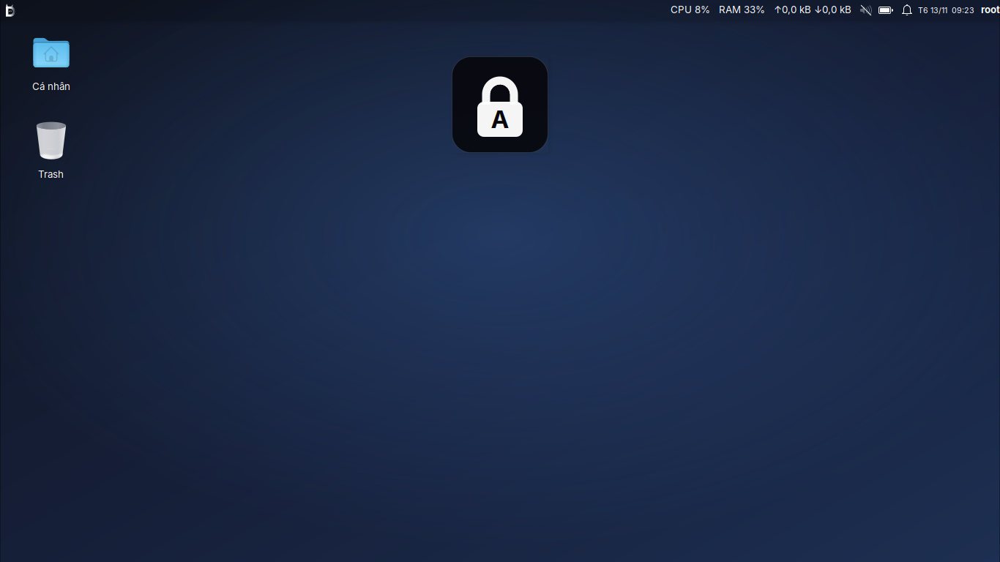
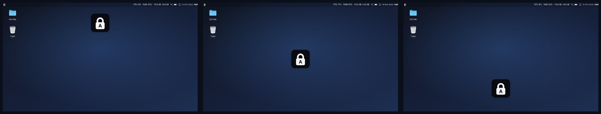

# depot-capslock — ô báo Caps Lock của Depot OS, đóng thành gói `.deb`

Mỗi lần bấm Caps Lock, một ô vuông bo góc hiện trên màn hình hơn một giây rồi tự tắt:

- **bật** → ổ khoá đóng + chữ `A`
- **tắt** → ổ khoá mở + chữ `a`

Ô báo vẽ bằng cairo (không cần bộ icon nào), không chiếm bàn phím, chuột bấm xuyên qua được.
Đây là ô báo có sẵn trong Depot OS (`depot-notify`), tách ra để cài được trên máy Debian / Ubuntu bất kỳ.

## Hình ảnh

**Bật và tắt** — trái: Caps Lock bật (ổ khoá đóng, chữ `A`); phải: Caps Lock tắt (ổ khoá mở, chữ `a`).


**Trên màn hình** — ô báo hiện giữa theo chiều ngang, phía trên, không che cửa sổ đang làm việc và tự tắt sau hơn một giây.



**Chọn chỗ hiện** — `POSITION=top` (mặc định), `center`, `bottom` trong `~/.config/depot-capslock.conf`.



Ảnh chụp bản 1.0.1 trong phiên XFCE của Depot OS v0.25 (màn hình ảo 1366×768).

| | |
|---|---|
| Tệp cài | [`depot-capslock_1.0.2_all.deb`](depot-capslock_1.0.2_all.deb) (kèm [`.sha256`](depot-capslock_1.0.2_all.deb.sha256)) — cũng có ở [GitHub Releases, bản `depot-capslock-1.0.2`](https://github.com/nguyenquocanhz/depot-os/releases/tag/depot-capslock-1.0.2) |
| Viết cho | Debian, Ubuntu và các bản dựa trên chúng có GTK 3.22 trở lên — phiên **X11**: XFCE, MATE, Cinnamon, LXQt, i3, Openbox (đã thử trên Debian 13 + XFCE và Ubuntu 24.04 + Openbox, xem cuối trang) |
| Cần | `python3`, `python3-gi`, `python3-gi-cairo`, `gir1.2-gtk-3.0` (apt tự kéo); nên có `fonts-inter` |
| Không chạy | phiên Wayland (GNOME / KDE mặc định): Wayland không báo trạng thái Caps Lock cho chương trình X11 |

## Cài

Tải `depot-capslock_1.0.2_all.deb` ở mục Assets của [bản phát hành `depot-capslock-1.0.2`](https://github.com/nguyenquocanhz/depot-os/releases/tag/depot-capslock-1.0.2)
(hoặc lấy tệp nằm ngay trong thư mục này), rồi:

```bash
sudo apt install ./depot-capslock_1.0.2_all.deb
```

Trên Depot OS: bấm đúp tệp `.deb` → **Chương trình và tính năng** → Cài.

Gói tự chạy cùng phiên làm việc từ lần đăng nhập sau. Muốn có ngay, không cần đăng xuất:

```bash
depot-capslock &
```

i3 không đọc thư mục tự khởi động — thêm vào `~/.config/i3/config`:

```
exec --no-startup-id depot-capslock
```

## Dùng

```
depot-capslock            chạy nền, hiện ô báo mỗi khi bật / tắt Caps Lock
depot-capslock --test     hiện thử "bật" rồi "tắt", xong thoát
depot-capslock --status   in on / off
depot-capslock --force    vẫn chạy trên Depot OS và ở phiên Wayland
depot-capslock --version
```

Tuỳ chỉnh trong `~/.config/depot-capslock.conf`, mỗi dòng `KHOÁ=giá trị`, có hiệu lực ngay lần bấm sau:

```
POSITION=top        # top (mặc định) | center | bottom
HOLD=1.3            # số giây ô báo nằm trên màn hình
ENABLED=0           # tạm tắt mà không gỡ gói
```

**Trên Depot OS** ô báo này đã có sẵn trong `depot-notify`, nên `depot-capslock` tự nhường và thoát
(không thì ra hai ô chồng nhau). Cài gói trên Depot OS vì thế không đổi gì — gói dành cho máy khác.

## Gỡ

```bash
sudo apt remove depot-capslock
```

## Đóng gói lại

Nguồn nằm trong [`pkg/`](pkg) — đúng cây thư mục sẽ nằm trên máy, cộng `DEBIAN/control`:

```
pkg/DEBIAN/control                               tên gói, phiên bản, gói phụ thuộc
pkg/DEBIAN/conffiles                             tệp tự khởi động là tệp cấu hình (xoá / sửa thì nâng cấp không ghi đè)
pkg/usr/bin/depot-capslock                       chương trình (Python + GTK 3)
pkg/etc/xdg/autostart/depot-capslock.desktop     tự chạy cùng phiên làm việc
pkg/usr/share/doc/depot-capslock/copyright       bản quyền và giấy phép (GPL-3), theo khuôn của Debian
```

Sửa xong thì tăng `Version` trong `control` và `VERSION` trong chương trình (script kiểm hai số phải khớp), rồi:

```bash
sh packages/depot-capslock/build.sh
```

Chạy trên Debian / Ubuntu hoặc trong WSL, không cần root. Script dựng cây gói ở thư mục tạm trên đĩa Linux
(để quyền file đúng dù nguồn nằm trên ổ Windows), từ chối tệp dính CRLF, tính `Installed-Size` và `md5sums`,
nén xz, ghi tệp `.deb` và `.sha256` cạnh script.

Phát hành bản mới: commit, đẩy lên `main`, rồi tạo bản phát hành với thẻ `depot-capslock-<phiên bản>` kèm hai tệp đó
(thẻ đặt theo tên gói để không lẫn với thẻ phiên bản ISO):

```bash
gh release create depot-capslock-1.1 packages/depot-capslock/depot-capslock_1.1_all.deb packages/depot-capslock/depot-capslock_1.1_all.deb.sha256 --target main --title "depot-capslock 1.1"
```

Các bản đã phát hành: <https://github.com/nguyenquocanhz/depot-os/releases>

Mã vẽ ổ khoá chép từ lớp `LockOSD` trong `usr/bin/depot-notify` của Depot OS — đổi hình ở bên nào thì đổi luôn bên kia.

## Giấy phép

GNU General Public License phiên bản 3 — nguyên văn ở tệp [LICENSE](../../LICENSE) của kho; sau khi cài, xem
`/usr/share/doc/depot-capslock/copyright`.

## Các bản

- **1.0.2** (14/11/2026) — sửa lỗi ô đen: chương trình khởi động khi có compositor (picom, xfwm4 bật hiệu ứng…), rồi
  compositor tắt giữa chừng, thì ô báo chỉ còn là một ô đen trơn không có ổ khoá. Bản 1.0 và 1.0.1 đều dính; nên nâng cấp.
- **1.0.1** (13/11/2026) — gói mang theo tệp `copyright` (GPL-3) và trường `Homepage`; chương trình không đổi cách chạy.
- **1.0** (13/11/2026) — bản đầu.

## Đã thử

Bản 1.0.2, trên màn hình ảo (Xvfb 1366×768), bấm phím bằng `xdotool`:

- **Ubuntu 24.04.5 trong WSL** (Python 3.12, GTK 3.24.41), phiên Openbox + picom, người dùng thường — 56 phép kiểm:
  `apt install ./tệp.deb` lên máy sạch kéo đủ gói phụ thuộc và `fonts-inter`, nâng cấp từ bản 1.0.1, gói tự chạy khi
  vào phiên, bật / tắt Caps Lock → ô báo hiện đúng hình rồi tự tắt, chuột xuyên qua ô báo, `POSITION` / `HOLD` /
  `ENABLED`, compositor tắt giữa chừng / bật lại / tắt đúng lúc ô báo đang hiện, không có `DISPLAY`, phiên Wayland,
  chỉ một bản chạy nền, không in cảnh báo nào (kể cả với `python3 -W error`), gỡ và purge.
- **Debian 13, phiên XFCE của ISO Depot OS v0.25** — 36 phép kiểm: nâng cấp từ bản 1.0, quyền tệp, tệp `copyright`,
  `dpkg --verify`, bật / tắt, ba tuỳ chỉnh, có và không có compositor, tự nhường trên Depot OS, gỡ và purge.

**Chưa thử**: bàn phím thật, cửa sổ thật qua WSLg, Ubuntu 22.04 / 26.04, Debian ngoài Depot, các môi trường khác
XFCE và Openbox, nhiều màn hình.
