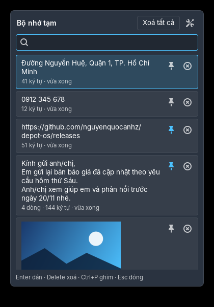
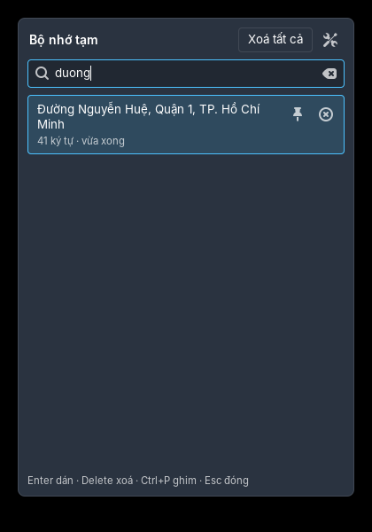
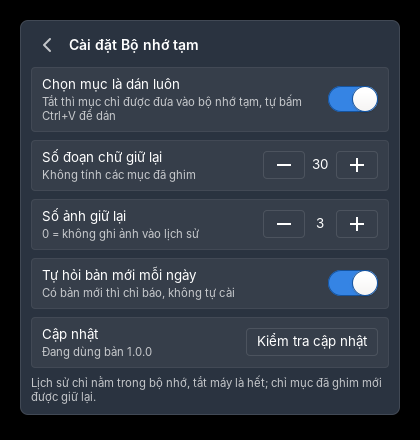
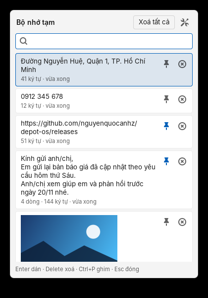

# depot-clipboard — Bộ nhớ tạm (Clipboard Manager) của Depot OS, đóng thành gói `.deb`

Giữ lịch sử những gì bạn đã sao chép (chữ và ảnh). Bấm **Win+V**, một bảng nhỏ hiện ngay chỗ con trỏ: gõ để tìm,
chọn mục nào là **dán luôn** vào cửa sổ đang làm việc — kiểu Windows 11.

- **Tìm ngay khi gõ**, gõ không dấu cũng ra chữ có dấu (`duong` ra "Đường…"); đang gõ dở bằng Unikey vẫn lọc theo.
- **Dán được cả vào Terminal** (bảng tự bấm Ctrl+Shift+V thay cho Ctrl+V; họ xterm: Shift+Insert).
- **Ghim** mục hay dùng: mục đã ghim không mất khi "Xoá tất cả", khi tắt máy hay khi lịch sử đầy.
- **Riêng tư**: lịch sử chỉ nằm trong bộ nhớ, tắt máy / đăng xuất là hết — mật khẩu vừa sao chép không nằm lại trên
  đĩa. Chỉ mục bạn tự ghim mới được ghi xuống `~/.local/share/depot-clipboard/` (quyền 600). Nội dung mà trình quản
  lý mật khẩu đánh dấu bí mật (KeePassXC…) không bao giờ vào lịch sử.
- **Tự cập nhật (OTA)**: mỗi ngày hỏi kho GitHub một lần, có bản mới thì báo; bấm một nút trong bảng là cài.

## Hình ảnh

**Bảng lịch sử** — mục mới nhất ở trên, đinh ghim xanh là mục đã ghim, ảnh có hình thu nhỏ.



**Tìm không dấu** — gõ `duong`, còn lại đúng mục "Đường Nguyễn Huệ…"; Enter là dán.



**Cài đặt và cập nhật** — bấm bánh răng ở góc bảng.



**Giao diện sáng** — bảng tự theo giao diện sáng / tối của máy.



Ảnh chụp bản 1.0.0 trên màn hình ảo 1366×768 (xfwm4 + picom).

| | |
|---|---|
| Tệp cài | [`depot-clipboard_1.0.0_all.deb`](depot-clipboard_1.0.0_all.deb) (kèm [`.sha256`](depot-clipboard_1.0.0_all.deb.sha256)) |
| Viết cho | Debian, Ubuntu và các bản dựa trên chúng có GTK 3.22 trở lên — phiên **X11**: XFCE, MATE, Cinnamon, LXQt, i3, Openbox |
| Cần | `python3`, `python3-gi`, `python3-gi-cairo`, `gir1.2-gtk-3.0`, `gir1.2-gdkpixbuf-2.0`, `libxtst6` (apt tự kéo); nên có `fonts-inter`, `libnotify-bin`, `pkexec` |
| Không chạy | phiên Wayland (GNOME / KDE mặc định): Wayland không cho chương trình X11 theo dõi bộ nhớ tạm của app khác |

## Cài

```bash
sudo apt install ./depot-clipboard_1.0.0_all.deb
```

Trên Depot OS: bấm đúp tệp `.deb` → **Chương trình và tính năng** → Cài.

Gói tự chạy cùng phiên làm việc từ lần đăng nhập sau. Muốn có ngay, không cần đăng xuất, bấm **Win+V** (Depot OS đã
gán sẵn) hoặc chạy:

```bash
depot-clipboard show
```

**Phím tắt Win+V.** Depot OS gán sẵn. Trên XFCE khác, lần đầu chạy nền gói tự gán Win+V nếu phím đó chưa gán cho gì
(gán lại bằng tay: `depot-clipboard bind`). Desktop khác: vào phần phím tắt bàn phím, thêm lệnh `depot-clipboard show`.
i3 không đọc thư mục tự khởi động — thêm vào `~/.config/i3/config`:

```
exec --no-startup-id depot-clipboard start
bindsym $mod+Shift+v exec --no-startup-id depot-clipboard show
```

**Trên Depot OS** gói này thay bản `depot-clipboard` cũ (một script gọi Clipman của XFCE) — cùng tên lệnh nên Win+V,
mục tự khởi động và `depot-layout` không phải đổi gì. Khi chạy nền, bản mới tắt `xfce4-clipman` đang chạy trên cùng
màn hình (hai trình giữ lịch sử cùng lúc thì giành nhau bộ nhớ tạm); thứ đang nằm trong bộ nhớ tạm lúc đó được giữ lại.
Bản cũ được cất ở `/usr/bin/depot-clipboard.clipman` (dpkg-divert) và **tự về chỗ cũ khi gỡ gói**.

## Dùng

Trong bảng:

| Phím | Việc |
|---|---|
| gõ chữ | tìm trong lịch sử (không dấu cũng được) |
| ↑ ↓, Tab, PgUp / PgDn | chọn mục |
| Enter hoặc bấm chuột | đưa mục vào bộ nhớ tạm và dán vào cửa sổ đang làm việc |
| Delete (khi ô tìm trống) | xoá mục đang chọn |
| Ctrl+P | ghim / bỏ ghim |
| Esc | xoá ô tìm; bấm lần nữa để đóng. Bấm ra ngoài bảng hoặc Win+V lần nữa cũng đóng |

Dòng lệnh:

```
depot-clipboard start          chạy nền, ghi lại những gì được sao chép (mục tự khởi động gọi lệnh này)
depot-clipboard show           mở / đóng bảng lịch sử — chưa chạy nền thì chạy luôn
depot-clipboard settings       mở bảng ở trang cài đặt
depot-clipboard clear          xoá lịch sử, giữ các mục đã ghim
depot-clipboard status         bản chạy nền có đang chạy không, đang giữ bao nhiêu mục
depot-clipboard quit           tắt bản chạy nền
depot-clipboard restart        chạy lại bản chạy nền
depot-clipboard bind           XFCE: gán Win+V (thêm --force để đè lệnh đang gán)
depot-clipboard --check-update hỏi kho GitHub có bản mới không (mã thoát 10 = có bản mới)
depot-clipboard --update       tải bản mới, đối chiếu sha256 rồi cài
depot-clipboard --version
```

Tuỳ chỉnh trong `~/.config/depot/clipboard`, mỗi dòng `KHOÁ=giá trị` (trang cài đặt của bảng sửa giúp bốn dòng đầu):

```
MAX_TEXTS=30        # số đoạn chữ giữ lại, không tính mục đã ghim (5–200)
MAX_IMAGES=3        # số ảnh giữ lại; 0 = không ghi ảnh
PASTE=0             # chọn một mục thì chỉ đưa vào bộ nhớ tạm, không tự dán
UPDATE_CHECK=0      # bản chạy nền không tự hỏi bản mới
THEME=dark          # dark | light — mặc định theo giao diện của máy
```

Không ghi vào lịch sử: vùng chữ đang bôi (chỉ lấy khi bấm Sao chép), đoạn chữ dài hơn 2 triệu ký tự, ảnh có cạnh
dài hơn 8192 điểm, nội dung được đánh dấu bí mật. Sao chép tệp trong trình quản lý tệp thì lịch sử giữ đường dẫn
dạng chữ.

## Cập nhật (OTA)

Trong bảng: **bánh răng › Cập nhật › Kiểm tra cập nhật**; có bản mới thì nút đổi thành **Cập nhật**, cài xong thì
thành **Chạy lại ngay**. Bằng dòng lệnh:

```bash
depot-clipboard --check-update   # "Có bản mới 1.1.0 (đang dùng 1.0.0)." — mã thoát 10; đang mới nhất thì mã thoát 0
depot-clipboard --update         # tải tệp .deb của bản mới, đối chiếu sha256, cài, rồi cho bản chạy nền chạy lại
```

- "Bản mới nhất" là bản nằm trên nhánh `main` của kho này: số phiên bản đọc ở `pkg/DEBIAN/control`, tệp `.deb` và
  `.sha256` lấy ngay trong thư mục này. Tệp tải về sai sha256 thì không cài.
- Bản chạy nền mỗi ngày hỏi một lần; có bản mới thì hiện một thông báo (mỗi phiên bản báo một lần) — **không tự cài**.
- Cài cần quyền quản trị: hộp hỏi mật khẩu của hệ thống (`pkexec`) hiện ra. Không có `pkexec` hoặc không ở phiên đồ
  hoạ thì `--update` chỉ tải về `~/.cache/depot-clipboard/` và in lệnh `sudo apt install …` để tự chạy.
- Chạy lại bản chạy nền thì lịch sử chưa ghim bắt đầu lại từ đầu (nó chỉ nằm trong bộ nhớ).

## Gỡ

```bash
sudo apt remove depot-clipboard
```

Bản chạy nền được tắt; trên Depot OS bản `depot-clipboard` cũ về lại chỗ cũ (Clipman chạy lại từ lần đăng nhập sau,
hoặc chạy ngay: `depot-clipboard start &`). Mục đã ghim và cấu hình nằm trong thư mục người dùng, muốn xoá thì:
`rm -r ~/.local/share/depot-clipboard ~/.config/depot/clipboard`.

## Đóng gói lại

Nguồn nằm trong [`pkg/`](pkg) — đúng cây thư mục sẽ nằm trên máy, cộng thư mục `DEBIAN`:

```
pkg/DEBIAN/control                                          tên gói, phiên bản, gói phụ thuộc
pkg/DEBIAN/preinst, postrm                                  cất / trả bản depot-clipboard cũ của Depot OS (dpkg-divert)
pkg/DEBIAN/prerm                                            gỡ gói thì tắt bản chạy nền
pkg/DEBIAN/conffiles                                        tệp tự khởi động là tệp cấu hình
pkg/usr/bin/depot-clipboard                                 chương trình (Python + GTK 3)
pkg/etc/xdg/autostart/depot-clipboard-app.desktop           tự chạy cùng phiên làm việc
pkg/usr/share/applications/depot-clipboard.desktop          mục "Bộ nhớ tạm" trong menu ứng dụng
pkg/usr/share/icons/hicolor/scalable/apps/depot-clipboard.svg   icon
pkg/usr/share/doc/depot-clipboard/copyright                 bản quyền và giấy phép (GPL-3)
```

Sửa xong thì tăng `Version` trong `control` và `VERSION` trong chương trình (script kiểm hai số phải khớp), rồi:

```bash
sh packages/depot-clipboard/build.sh
```

Chạy trên Debian / Ubuntu hoặc trong WSL, không cần root. Script từ chối tệp dính CRLF, kiểm cú pháp chương trình,
ba script cài đặt và hai tệp `.desktop`, tính `Installed-Size` và `md5sums`, nén xz, ghi tệp `.deb` và `.sha256` cạnh
script (tệp của phiên bản cũ bị xoá để thư mục chỉ có một bản).

Phát hành bản mới: commit, đẩy lên `main`, rồi tạo bản phát hành với thẻ `depot-clipboard-<phiên bản>` kèm hai tệp đó:

```bash
gh release create depot-clipboard-1.0.0 packages/depot-clipboard/depot-clipboard_1.0.0_all.deb packages/depot-clipboard/depot-clipboard_1.0.0_all.deb.sha256 --target main --title "depot-clipboard 1.0.0 — Bộ nhớ tạm (.deb)"
```

Bản đã cài ở máy người dùng tự thấy bản mới ngay khi `main` có số phiên bản lớn hơn kèm tệp `.deb` và `.sha256`
tương ứng trong thư mục này — nên chỉ đẩy lên `main` khi cả ba đã khớp nhau.

## Giấy phép

GNU General Public License phiên bản 3 — nguyên văn ở tệp [LICENSE](../../LICENSE) của kho; sau khi cài, xem
`/usr/share/doc/depot-clipboard/copyright`.

## Các bản

- **1.0.0** (17/11/2026) — bản đầu: bảng lịch sử riêng thay cho menu của Clipman, tìm kiếm, ghim, ảnh thu nhỏ, dán
  được vào Terminal, cập nhật OTA, gói `.deb`.

## Đã thử

Bản 1.0.0, trên **Depot OS v0.26 chạy từ USB** (Debian 13, Python 3.13, GTK 3.24.49):

- **Chương trình**, trên một màn hình ảo riêng (Xvfb 1366×768, thư mục người dùng giả, bấm phím bằng XTest) để không
  đụng vào bộ nhớ tạm thật của máy —
  - với **xfwm4** (có và không có picom): ghi chữ và ảnh, sao chép lại thì đưa lên đầu chứ không lặp, bỏ qua nội dung
    đánh dấu bí mật, `MAX_TEXTS`; mở bảng thì bảng nhận bàn phím; Enter / tìm không dấu rồi Enter → **dán đúng chữ có
    dấu vào ô nhập của cửa sổ cũ**, cửa sổ cũ được chọn lại; **dán vào xfce4-terminal** (Ctrl+Shift+V); `PASTE=0`;
    ghim (tệp trên đĩa quyền 600), xoá mục, `clear` giữ mục ghim, chạy lại còn đúng mục ghim; chọn ảnh → bộ nhớ tạm là
    ảnh; app nguồn thoát → thứ vừa sao chép được đặt lại; Esc, Win+V lần hai, bấm ra ngoài đều đóng bảng; cửa sổ đích
    bị đóng giữa chừng không làm sập; bảng mở sát mép màn hình thì lùi vào trong; giao diện tối / sáng; gõ trong ô
    tìm qua fcitx5-unikey thật (lọc theo cả phần chữ bộ gõ đang giữ); tiếp quản từ một `xfce4-clipman` chạy trên màn
    hình ảo mà **không đụng Clipman của màn hình thật**;
  - với **i3**: mở bằng phím tắt thật `$mod+Shift+v`, bảng nổi và nhận bàn phím, Enter dán đúng.
- **Cập nhật OTA** với một kho giả trên máy (`DEPOT_CLIPBOARD_UPDATE_URL=http://127.0.0.1:…`, bản 1.0.1): thấy bản
  mới (mã thoát 10), kho không tới được (mã thoát 1), tải `.deb` + khớp sha256, **từ chối tệp sai sha256**; bản chép
  tay: nút Kiểm tra → Cập nhật → Chạy lại ngay trong bảng lên đúng 1.0.1, `--update` tự cho bản chạy nền chạy lại.
- **Gói `.deb`** cài thật bằng `sudo apt install ./depot-clipboard_1.0.0_all.deb` trên chính máy đó: apt không kéo
  thêm gói nào, bản `depot-clipboard` cũ được cất nguyên vẹn sang `.clipman`, đủ tệp, `depot-clipboard --version` ra
  1.0.0; `dpkg --verify` chỉ báo tệp `.desktop` khác — do Depot OS tự thêm mục "Gỡ cài đặt" vào mọi tệp `.desktop`;
  `apt remove` → bản cũ về đúng chỗ cũ, giống từng byte.
- **Phiên XFCE thật** của máy đó (17/11/2026, gói cài bằng apt): người dùng bấm Win+V thật → bản mới tự chạy nền, bảng
  mở ("chạy tốt"), `xfce4-clipman` của phiên được tắt; sao chép một đoạn chữ từ chương trình khác → vào lịch sử, chương
  trình đó thoát thì bộ nhớ tạm vẫn còn đúng đoạn chữ.

**Chưa thử**: trong phiên XFCE thật — dán vào từng loại app (mới thử trên màn hình ảo), ảnh, ghim, tự chạy lúc đăng
nhập lại, gỡ gói lúc bản chạy nền đang chạy; `--update` qua hộp hỏi mật khẩu `pkexec` và cài bản mới từ kho GitHub
thật (cần có bản sau 1.0.0); dán vào app Qt / Electron / Chrome; họ xterm (Shift+Insert); thông báo "có bản mới" của bản chạy nền; Ubuntu, máy không
có Depot OS, MATE / Cinnamon / LXQt / Openbox; nhiều màn hình; màn hình HiDPI.

**Chưa làm cho ISO**: ISO vẫn mang bản cũ dùng Clipman. Đưa bản mới vào ISO (thay tệp trong `includes.chroot`, bỏ
`xfce4-clipman` khỏi danh sách gói, sửa `check-v23.sh`, mục "Bộ nhớ tạm" trong `depot-settings` và ô Clipman trong
`depot-tray`) là việc riêng, cần build và boot thử ISO.
