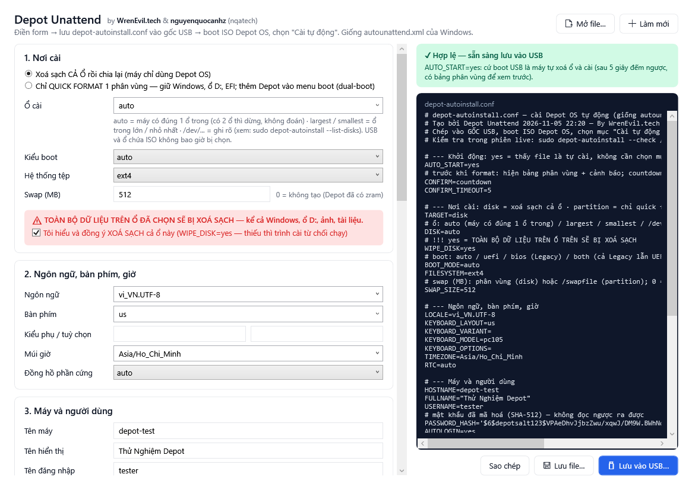
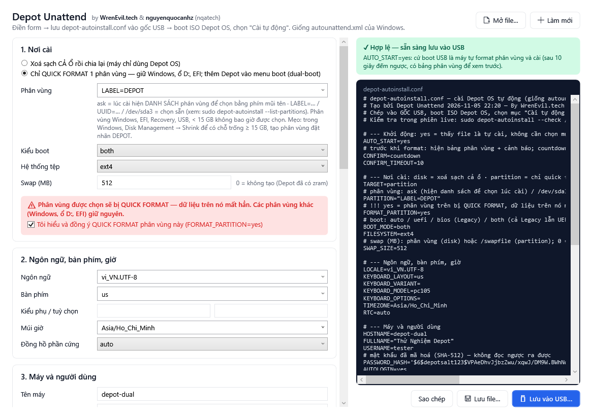
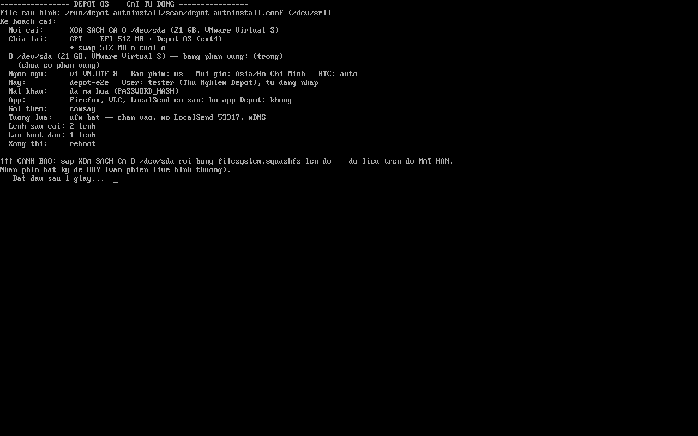
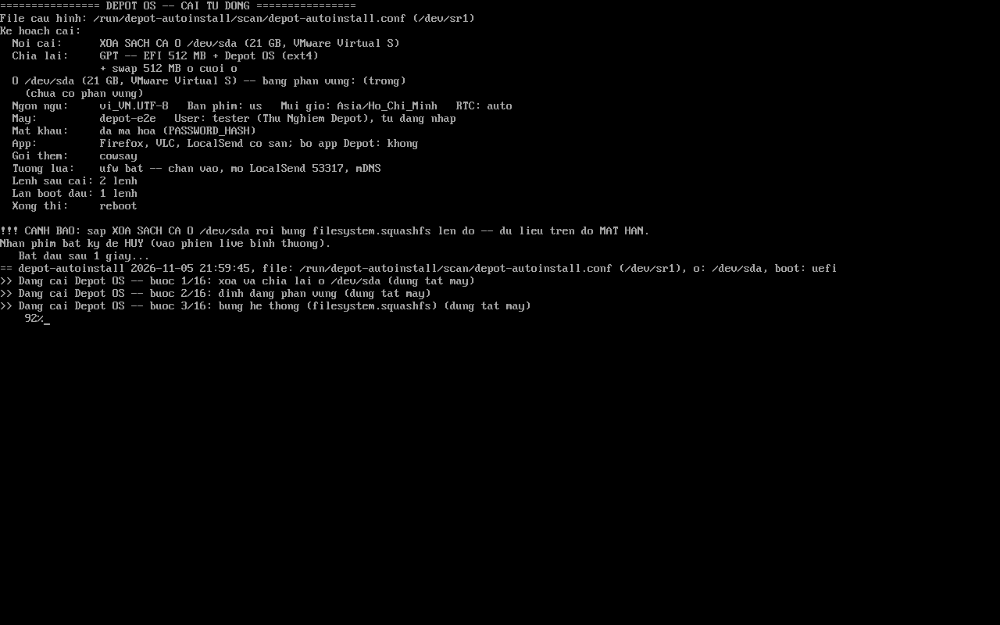

# Cài Depot OS tự động (giống autounattend.xml của Windows)

By WrenEvil.tech & nguyenquocanhz (nqatech)

Cài Depot OS không phải bấm gì: ổ đĩa / phân vùng, kiểu boot, ngôn ngữ, bàn phím, múi giờ, user, mật khẩu, tên máy,
OpenSSH + tường lửa, gói cài thêm và lệnh chạy sau khi cài đều nằm trong một file `depot-autoinstall.conf`.

- **Xoá cả ổ** (`TARGET=disk`) hoặc **chỉ quick format 1 phân vùng** (`TARGET=partition`) — giữ Windows, ổ D:,
  phân vùng EFI; thêm Depot OS vào menu boot (GRUB liệt kê cả Windows → khởi động kép).
- `PARTITION=ask`: lúc cài hiện **danh sách phân vùng** để chọn bằng phím mũi tên.
- Trước khi format luôn hiện **bảng phân vùng** (cái nào FORMAT, cái nào giữ nguyên) và **cảnh báo**, rồi đếm ngược
  (phím bất kỳ = huỷ) hoặc hỏi Cài / Huỷ (`CONFIRM=ask`).
- Boot **UEFI, Legacy BIOS hoặc cả hai** (`BOOT_MODE=both`).
- Firefox, VLC, LocalSend có sẵn trong ISO (cài được không cần mạng).
- **OpenSSH** cổng 22 (hoặc cổng khác) + **ufw**; user SSH riêng có **chỗ lưu trữ riêng** (thư mục hoặc phân vùng riêng).

| Thành phần | Ở đâu | Làm gì |
|---|---|---|
| `depot-autoinstall` | trong ISO, `/usr/bin/` | trình cài không giao diện, làm đúng các bước Calamares của Depot OS đang làm |
| `depot-autoinstall.service` | trong ISO | lúc boot phiên live: tìm file cấu hình, đếm ngược, rồi cài |
| Mục boot **"Cài tự động Depot OS"** | menu GRUB (UEFI) và isolinux (BIOS) | boot thêm tham số `depot.autoinstall` |
| `depot-autoinstall.conf` | thư mục này | file mẫu, chú thích tiếng Việt |
| **Depot Unattend** | `DepotUnattend/` | app Windows điền form → xuất file cấu hình (kiểu Windows System Image Manager) |
| `embed-iso.sh` | thư mục này | nhúng file cấu hình vào ISO có sẵn, không build lại |




Lúc boot — bảng phân vùng + cảnh báo trước khi bung hệ thống, rồi tiến độ (máy ảo VMware, chế độ xoá cả ổ):




## Dùng nhanh (3 bước)

1. **Tạo file cấu hình**: mở app *Depot Unattend* trên Windows, điền form, bấm **Lưu vào USB…**
   (hoặc chép `depot-autoinstall.conf` ở đây rồi sửa bằng Notepad).
2. **Chép vào gốc USB**: cùng USB chứa ISO nếu dùng Ventoy, hoặc một USB thứ hai. Tên file phải đúng
   `depot-autoinstall.conf`, nằm ngay gốc (vd `E:\depot-autoinstall.conf`).
3. **Boot ISO Depot OS → chọn "Cài tự động Depot OS (XOÁ Ổ…)"**. Máy hiện ổ sẽ bị xoá và đếm ngược 15 giây
   (nhấn phím bất kỳ để huỷ), rồi tự cài, tiến độ hiện trên màn boot. Xong thì khởi động lại vào máy mới.

Muốn khỏi chọn mục boot (cài hàng loạt nhiều máy): đặt `AUTO_START=yes` trong file. Khi đó cứ boot USB là cài.

> ⚠️ **XOÁ DỮ LIỆU.** `TARGET=disk`: cả ổ (`DISK=`) mất hết, kể cả Windows — file phải có `WIPE_DISK=yes`.
> `TARGET=partition`: chỉ phân vùng được chọn mất dữ liệu — file phải có `FORMAT_PARTITION=yes`.
> `DISK=auto` chỉ tự chọn khi máy có **đúng 1 ổ trong**; có 2 ổ trở lên thì dừng, không đoán.
> USB, ổ chứa ISO / file cấu hình, phân vùng Windows, EFI, MSR, Recovery không bao giờ bị format.

### Cài cạnh Windows (dual-boot) — giống chọn phân vùng trong Windows Setup

1. Trong Windows: *Disk Management* → chuột phải ổ C: → **Shrink Volume** lấy ≥ 15 GB → **New Simple Volume**,
   đặt nhãn (Volume label) `DEPOT`.
2. Trong file: `TARGET=partition`, `PARTITION=LABEL=DEPOT` (hoặc `ask` để chọn lúc cài), `FORMAT_PARTITION=yes`.
3. Boot USB → chọn "Cài tự động". Máy hiện bảng phân vùng: `DEPOT` → **FORMAT**, EFI → **dùng chung**, còn lại
   **giữ nguyên**. Cài xong, menu GRUB có cả Depot OS lẫn Windows Boot Manager.

Máy Legacy BIOS (MBR): GRUB ghi vào MBR của ổ, vẫn có mục Windows. Ổ GPT muốn boot Legacy cần phân vùng
*BIOS boot* 1–2 MB; không có thì `BOOT_MODE=both` chỉ cài UEFI và ghi cảnh báo.

## Trình cài tìm file ở đâu

Giống Windows tìm `autounattend.xml`:

1. Gốc mọi phân vùng trên **USB / ổ rời / đĩa CD** (FAT32, exFAT, NTFS, ext4, ISO…).
2. Gốc **ISO**. Hai cách nhúng:
   - không build lại — nhúng vào ISO có sẵn (WSL, cần `sudo apt install xorriso`):
     ```bash
     bash tools/autoinstall/embed-iso.sh depot-os-v0.18-amd64.iso depot-autoinstall.conf depot-os-v0.18-tu-cai.iso
     ```
     ISO gốc giữ nguyên, ISO mới vẫn boot UEFI + BIOS. Tốn thêm ~1,9 GB.
   - lúc build: đặt file vào `build/live-build/config/includes.binary/depot-autoinstall.conf` rồi build
     (file này có mật khẩu, đã được `.gitignore` bỏ qua).
3. Chỉ khi boot bằng mục "Cài tự động": thêm gốc các phân vùng **ổ trong máy** (vd ổ D: của Windows).

Tham số kernel `depot.noautoinstall` (bấm `e` ở menu GRUB để thêm) tắt hẳn việc tự cài.

Chống cài lặp: máy đã cài bằng đúng file này mà vẫn boot vào USB (`AUTO_START=yes`) thì trình cài nhận ra và bỏ
qua. Muốn cài lại thì chọn mục boot "Cài tự động".

## Kiểm tra trước khi cài (không đụng ổ)

Trong phiên live, mở Terminal:

```bash
sudo depot-autoinstall --check /media/depot/USB/depot-autoinstall.conf   # kiểm file + in kế hoạch
sudo depot-autoinstall --check            # tự tìm file như lúc boot
sudo depot-autoinstall --list-disks       # xem tên ổ để ghi vào DISK=
sudo depot-autoinstall --list-partitions  # bảng phân vùng: cái nào là Windows / EFI, cái nào cài vào được
sudo depot-autoinstall --run FILE         # cài ngay từ phiên live (bắt gõ XOA để xác nhận)
```

## Các khoá trong file

| Khoá | Mặc định | Ý nghĩa |
|---|---|---|
| `AUTO_START` | `no` | `yes` = thấy file là tự cài, không cần chọn mục boot |
| `CONFIRM` | `countdown` | trước khi format: hiện bảng phân vùng + cảnh báo, rồi `countdown` (đếm ngược) / `ask` (hỏi Cài/Huỷ) |
| `CONFIRM_TIMEOUT` | `15` | giây đếm ngược (phím bất kỳ = huỷ), `0` = không đợi |
| `TARGET` | `disk` | `disk` = xoá cả ổ · `partition` = chỉ quick format 1 phân vùng |
| `DISK` | `auto` | (disk) `auto` / `largest` / `smallest` / `/dev/sda` / `/dev/nvme0n1` / `/dev/disk/by-id/…` |
| `WIPE_DISK` | — | (disk) **bắt buộc `yes`** |
| `PARTITION` | `ask` | (partition) `ask` / `/dev/sda3` / `LABEL=DEPOT` / `UUID=…` |
| `FORMAT_PARTITION` | — | (partition) **bắt buộc `yes`** |
| `BOOT_MODE` | `auto` | `auto` theo máy / `uefi` / `bios` (Legacy) / `both` (cả hai) |
| `FILESYSTEM` | `ext4` | `ext4` / `btrfs` |
| `SWAP_SIZE` | `0` | MB; disk → phân vùng swap, partition → `/swapfile`; 0 = không (Depot đã có zram) |
| `LOCALE` | `vi_VN.UTF-8` | ngôn ngữ hệ thống |
| `KEYBOARD_LAYOUT` / `_VARIANT` / `_MODEL` / `_OPTIONS` | `us` / – / `pc105` / – | bàn phím (gõ tiếng Việt dùng Unikey có sẵn) |
| `TIMEZONE` | `Asia/Ho_Chi_Minh` | múi giờ IANA |
| `RTC` | `auto` | đồng hồ phần cứng: `auto` (có Windows thì giờ địa phương) / `local` / `utc` |
| `HOSTNAME` | — | tên máy |
| `FULLNAME`, `USERNAME` | — | tên hiển thị, tên đăng nhập (nhóm `sudo`; tài khoản root khoá) |
| `PASSWORD_HASH` / `PASSWORD` | — | nên dùng hash `$6$…` (app tự tạo, hoặc `openssl passwd -6`) |
| `AUTOLOGIN` | `no` | tự đăng nhập vào desktop |
| `WIFI_SSID`, `WIFI_PASSWORD` | — | Wi-Fi để tải app lúc cài; máy mới nhớ luôn mạng này |
| `INSTALL_APPS` | `yes` | tải thêm bộ app Depot lúc cài (Firefox, VLC, LocalSend luôn có sẵn) |
| `EXTRA_PACKAGES` | — | gói Debian cài thêm, cách nhau bằng dấu cách (cần mạng) |
| `SSH` | `no` | `yes` = bật OpenSSH server (khoá máy chủ riêng cho từng máy, root bị chặn) |
| `SSH_PORT` | `22` | cổng SSH |
| `SSH_USER` | — | user riêng cho SSH (không sudo); trống = SSH bằng user chính. `AllowUsers` chỉ cho user này |
| `SSH_PASSWORD_HASH` / `SSH_PASSWORD` | — | mật khẩu user SSH |
| `SSH_AUTHORIZED_KEY` | — | 1 dòng public key (`ssh-ed25519 AAAA…`) |
| `SSH_PASSWORD_AUTH` | `yes` | `no` = chỉ đăng nhập bằng key |
| `SSH_SUDO` | `no` | cho user SSH quyền sudo |
| `SSH_STORAGE` | `/srv/<user>` | chỗ lưu trữ riêng (home của user SSH): thư mục, hoặc phân vùng `/dev/sdb1` / `LABEL=…` gắn vào `/srv/<user>` |
| `SSH_STORAGE_FORMAT` | `no` | `yes` = quick format phân vùng lưu trữ (ext4) |
| `FIREWALL` | `yes` | ufw: chặn mọi kết nối vào, chỉ mở SSH (`limit`, chống dò mật khẩu), LocalSend 53317, mDNS 5353 |
| `POST_INSTALL` | — | lệnh chạy ngay sau khi cài, trong máy mới, quyền root; nhiều dòng được |
| `FIRSTBOOT` | — | lệnh chạy 1 lần ở lần khởi động đầu (có mạng); nhiều dòng được |
| `FINISH` | `reboot` | `reboot` / `poweroff` / `none` |

Thư mục `depot-files/` đặt cạnh file cấu hình được chép đè vào gốc máy mới (giống `$OEM$\$1` của Windows),
vd `depot-files/etc/hosts` → `/etc/hosts`.

Log: trong lúc cài `/run/depot-autoinstall/install.log`; trên máy đã cài `/var/log/depot/autoinstall.log`
(lệnh FIRSTBOOT: `/var/log/depot/firstboot.log`).

## Trình cài làm những gì

Theo thứ tự các bước `exec` trong `/etc/calamares/settings.conf` của Depot OS:

1. Hiện bảng phân vùng + cảnh báo, đếm ngược / hỏi.
2. `TARGET=disk`: chia ổ (`parted`) — UEFI → GPT + EFI 512 MB; BIOS → MBR; both → GPT + BIOS boot + EFI.
   `TARGET=partition`: quick format đúng phân vùng đó (đổi loại sang Linux), dùng lại phân vùng EFI có sẵn.
3. Bung hệ thống từ `filesystem.squashfs` (hiện %).
4. machine-id, `fstab` theo UUID (SSD thêm `discard`).
5. Ngôn ngữ, bàn phím (console + X11), múi giờ, tên máy, `/etc/hosts`.
6. Tạo user, nhóm như `users.conf` của Calamares, mật khẩu, khoá root, tự đăng nhập (LightDM).
7. Giờ phần cứng: `hwclock` + `depot-rtc --target` (giữ giờ địa phương nếu có Windows).
8. Nguồn apt cuối (đủ `contrib non-free`).
9. Bootloader: có mạng thì cài gói `grub-efi-amd64` / `grub-pc` như Calamares; `grub-install` UEFI (qua shim,
   chạy được với Secure Boot, thêm mục "depot" vào menu boot của firmware) và/hoặc Legacy (MBR);
   bản dự phòng `EFI/BOOT/BOOTX64.EFI` (không ghi đè nếu Windows đã có).
10. Gỡ gói của phiên live (như `packages.conf`), tạo initramfs, menu GRUB (os-prober thêm Windows).
11. Tải app Depot (`depot-install-apps --target`, như bước `shellprocess@depotapps`), gói thêm.
12. OpenSSH (khoá máy chủ mới, `sshd_config.d/50-depot.conf`), user SSH + lưu trữ riêng, ufw.
13. File `depot-files/`, `POST_INSTALL`, cài sẵn `FIRSTBOOT`.

## App Depot Unattend (Windows)

```bash
cd tools/autoinstall/DepotUnattend
dotnet build -c Release
```

Chạy `bin/Release/net8.0-windows/DepotUnattend.exe` (cần .NET 8 Desktop Runtime). App kiểm lỗi theo đúng luật của
trình cài, mã hoá mật khẩu SHA-512 (`$6$`, giống `openssl passwd -6`), mở lại được file cũ, và có nút
**Lưu vào USB…** ghi thẳng `depot-autoinstall.conf` vào gốc USB.

## Chưa làm

- Mã hoá ổ (LUKS).
- Tự thu nhỏ phân vùng Windows (shrink) — làm trong Windows trước (Disk Management), trình cài chỉ format phân vùng có sẵn.
- `/home` riêng hoặc nhiều phân vùng tự định nghĩa.
